# Cooperise 协作平台 · 系统介绍

Cooperise 是一套面向研发团队的**事项协作与项目管理平台**，覆盖需求、任务、缺陷从创建、流转到上线的全过程。系统按「空间」组织团队与项目，支持自定义问题类型、字段、模板与工作流，并提供列表、看板、甘特、日历、上线清单等多种视图。

同一套业务能力以**三端**形式提供：

| 端 | 适用场景 | 访问方式 |
|---|---|---|
| **网页版** | 日常办公、配置管理，功能最完整 | 浏览器访问 `https://<域名>/` |
| **桌面客户端** | 长时间使用、多页面并行处理 | Windows / macOS 安装包（Electron） |
| **手机 H5** | 外出时查看、处理事项，适配 iPhone 17 / 17 Pro Max | 手机浏览器访问 `https://<域名>/h5/`（手机打开网页版会自动跳转） |

> 截图取自开发环境（数据为测试数据）：网页版视口 1440×900，手机 H5 为 iPhone 17 尺寸（402×874）。

---

## 目录

1. [整体架构](#1-整体架构)
2. [核心概念](#2-核心概念)
3. [网页版](#3-网页版)
4. [桌面客户端](#4-桌面客户端)
5. [手机 H5](#5-手机-h5)
6. [管理后台](#6-管理后台)
7. [国际化](#7-国际化)
8. [三端功能对照](#8-三端功能对照)
9. [开发与部署](#9-开发与部署)

---

## 1. 整体架构

```
                    ┌──────────────── 前端 cooperise ────────────────┐
  浏览器  ────────▶ │  网页版        Vue 3 + Ant Design Vue + vxe 表格 │
  桌面客户端 ─────▶ │  （Electron 壳加载同一套网页，另有页签栏 / MCP）   │ ──┐
  手机浏览器 ─────▶ │  手机 H5      Vue 3 + Vant 4（独立入口 /h5/）     │   │  /api
                    └──────────────────────────────────────────────────┘   │
                                                                           ▼
                    ┌──────────────── 后端 faiz ──────────────────────┐
                    │  Spring Boot + MyBatis-Plus + MySQL               │
                    │  事项 / 视图 / 空间 / 工作流 / 用户权限 / 国际化   │
                    └──────────────────────────────────────────────────┘
```

| 层 | 技术 | 代码位置 |
|---|---|---|
| 网页版 | Vue 3、Vite、Ant Design Vue 4、vxe-table / vxe-gantt、qiankun（可作为微前端子应用） | `cooperise/src`（`src/pages`、`src/layout`、`src/components`） |
| 桌面客户端 | Electron 33，加载网页版；主进程负责窗口、页签、MCP 服务 | `cooperise/electron` |
| 手机 H5 | Vue 3、Vant 4，独立入口 `h5.html`，只复用接口层与登录、国际化等逻辑 | `cooperise/src/h5` |
| iOS App 壳 | Capacitor（在原生壳里加载前端） | `cooperise/ios`、`capacitor.config.ts` |
| 后端 | Spring Boot、MyBatis-Plus、MySQL，JWT 登录 | `faiz`（`faiz-api` / `faiz-service` / `faiz-dao`） |

---

## 2. 核心概念

| 概念 | 说明 |
|---|---|
| **空间** | 团队 / 项目的容器。每个空间有自己的标识（如 `POS`，用作单号前缀 `POS-000083`）、问题类型、模板、字段、工作流与成员。顶部切换「当前空间」后，事项、视图、看板都只看该空间 |
| **事项** | 需求、任务、缺陷等工作项的统称，由「问题类型」区分，带概要、描述、状态、经办人、优先级、计划日期及自定义字段 |
| **问题类型** | 如需求、任务、缺陷、故事；每种类型可配置自己的状态、模板与工作流 |
| **工作流** | 事项状态的流转规则（节点 + 连线，支持回退），事项只能按流程走到允许的下一步 |
| **字段** | 系统字段（概要、状态、经办人等）+ 自定义字段（单选、多选、人员、日期、数字、级联、富文本等），可配置在哪些场景（新建 / 编辑 / 详情 / 列表）展示、必填、可编辑 |
| **视图** | 保存好的筛选 + 排序 + 展示方式，类型有列表、看板、甘特、日历、上线清单；可放进文件夹 |
| **我的看板** | 个人工作台，由若干「面板」组成（如「待我处理」「我创建的」），每个面板是一组固定条件的事项 |

---

## 3. 网页版

### 3.1 我的看板

登录后的首页。左侧是工作台菜单（我的看板、我的事项、我的视图），顶部是空间切换、全局搜索、中英文切换与新建按钮。看板由多个面板组成，每个面板按问题类型、人员关系、状态范围和自定义条件筛出事项。

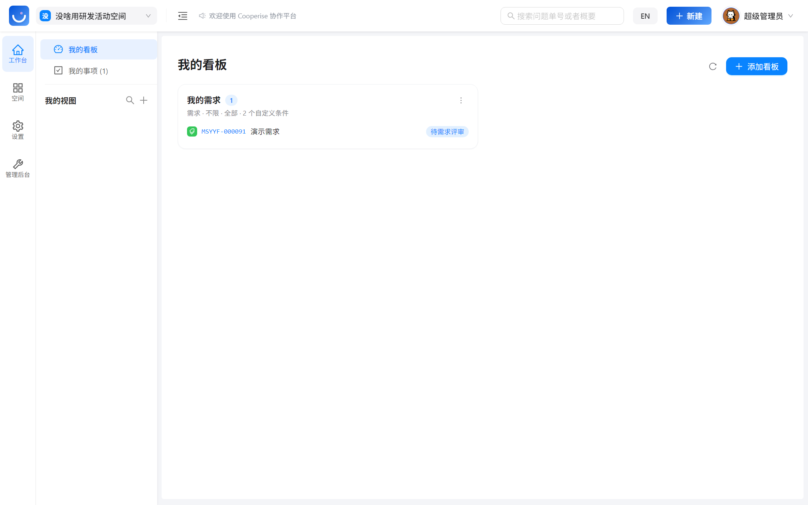

### 3.2 我的事项

以表格展示事项，默认条件为「经办人 = 当前用户、状态 = 所有未结束状态」。

- **全局筛选**：任意字段 + 操作符（属于 / 包含 / 早于 / 为空…）+ 值，支持「满足全部 / 任一」
- **排序**：多字段依次排序
- **列设置**：选择展示的字段与顺序
- **单元格编辑**：直接在表格里修改字段
- 概要旁的快捷操作：复制概要、复制链接、**打开链接**（网页版新开页面，客户端新开页签）

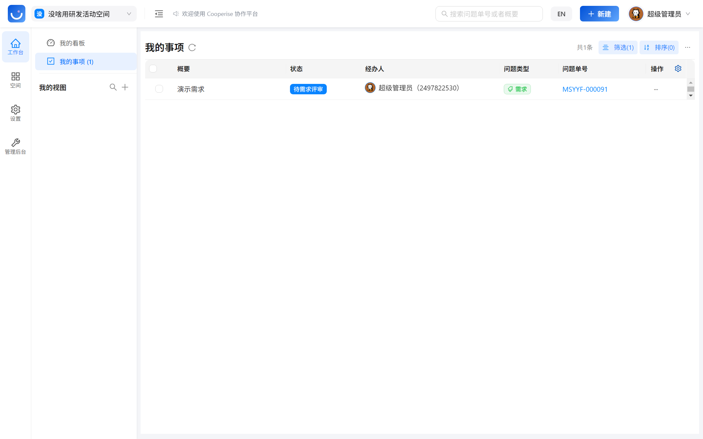

### 3.3 视图

视图保存筛选、排序、分组与展示字段，左侧「我的视图」支持新建视图和文件夹、编辑、删除。**看板视图**按状态分列，卡片可拖动流转（只允许拖到工作流允许的下一步）。

其他视图类型：**甘特图**（按计划开始 / 完成日期排期）、**测试日历**、**上线清单**（按批次汇总上线事项，开发 / 测试分别填写）。

### 3.4 事项详情

在列表里点概要，从右侧滑出详情抽屉；也可以用独立页面 `/jira/browse/单号` 打开（「打开链接」）：

- 头部：空间、单号、概要（可直接编辑）、问题类型、状态、优先级；复制单号、收藏、复制链接、打开链接
- 字段按分组展示：团队管理字段、人员信息、时间信息、描述（富文本）、补充信息，支持「仅展示有值字段」
- 操作按钮：流转状态、编辑、指派、拆分子任务、复制
- 父子事项、关联事项、研发活动、评论（支持引用、@人）、变更动态

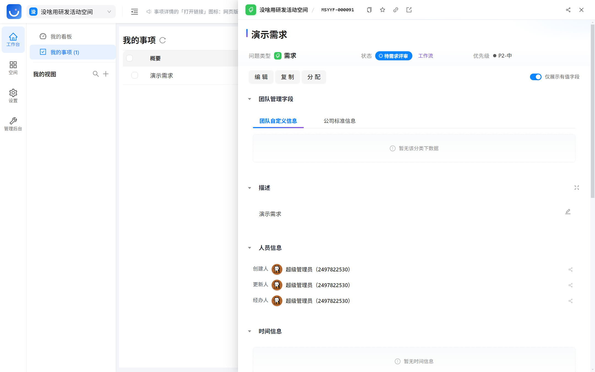

独立详情页：

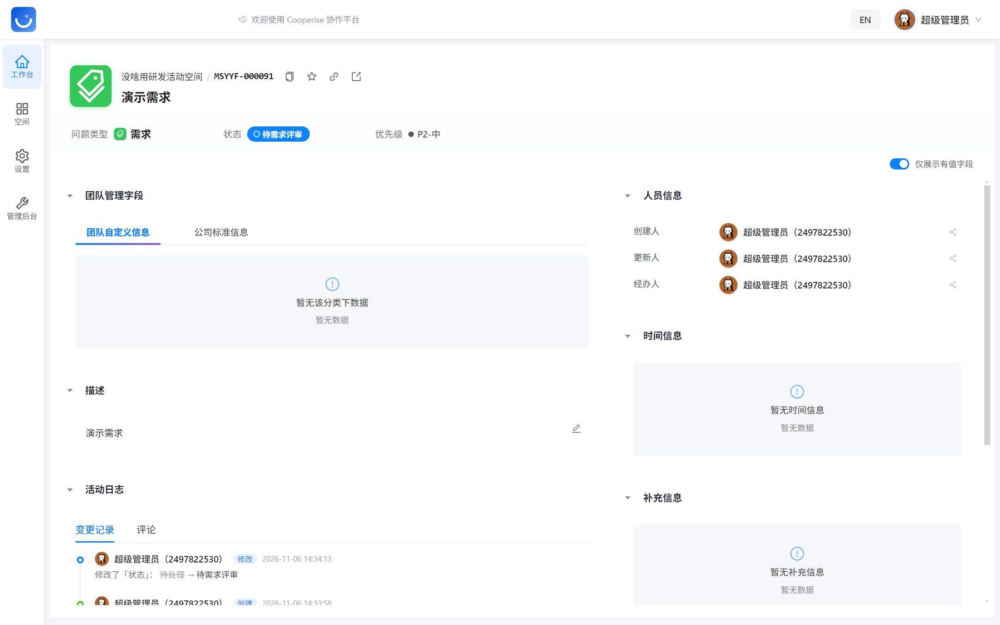

### 3.5 新建事项

选择空间、问题类型后按模板生成表单，分「必填 / 选填」两个页签；支持选择模板、保存为模板。

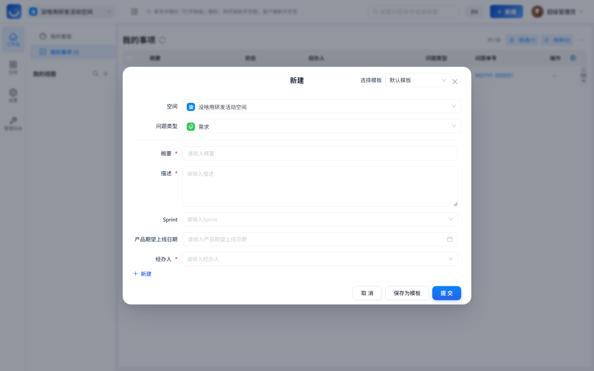

### 3.6 空间

空间列表：标识、编码、所属组织、负责人、启用状态；可新建、编辑、启停、删除，「进入空间」进入空间配置。

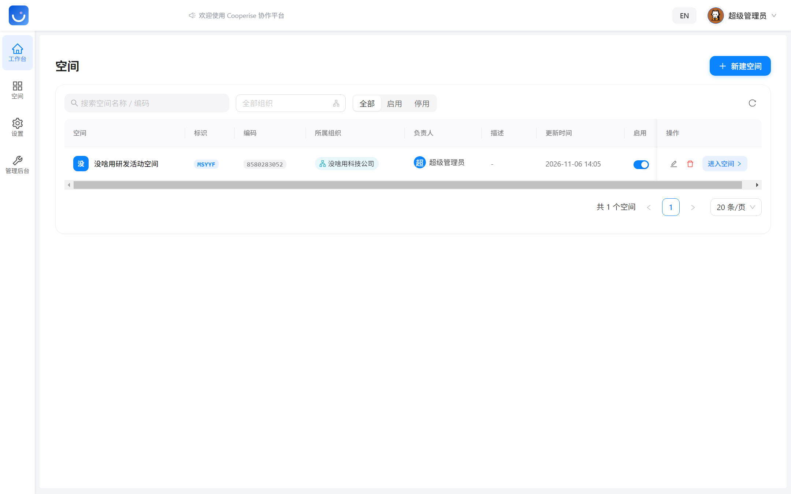

进入空间后可配置该空间的**问题类型、模板、字段、工作流、按钮**：

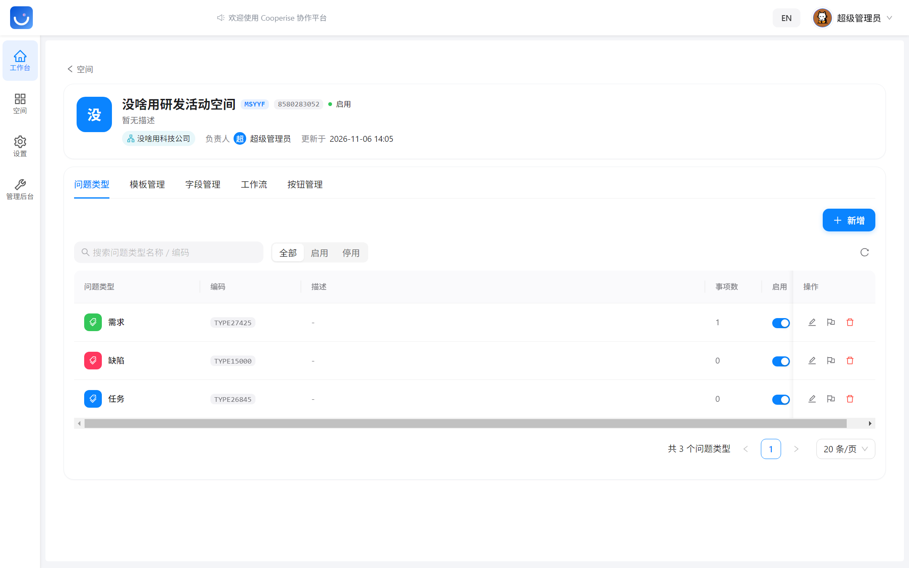

---

## 4. 桌面客户端

桌面客户端（Electron）加载网页版，功能与网页版一致，并针对长时间使用做了增强：

- **顶部页签栏**：每个打开的页面一个页签，可拖动排序；图标区分「链接 / 菜单 / 页面」三种来源；右键或「⋯」菜单关闭当前 / 其他 / 全部页签；页签会记住，重启后恢复
- **自绘窗口按钮**：Windows 下最小化 / 最大化 / 关闭按钮与页签栏同高同色；macOS 保留系统红绿灯
- **打开链接新开页签**：事项的「打开链接」在客户端里新开一个页签，而不是跳出浏览器
- **记住登录**：账号密码由系统加密保存（Windows DPAPI / macOS Keychain）
- **开机自启动**、快捷键（刷新、缩放、全屏、开发者工具）
- **MCP 服务**：客户端内置 MCP 服务，AI 助手可以以当前登录用户的身份查询、处理事项（在「客户端设置」里开关、查看地址与访问密钥）

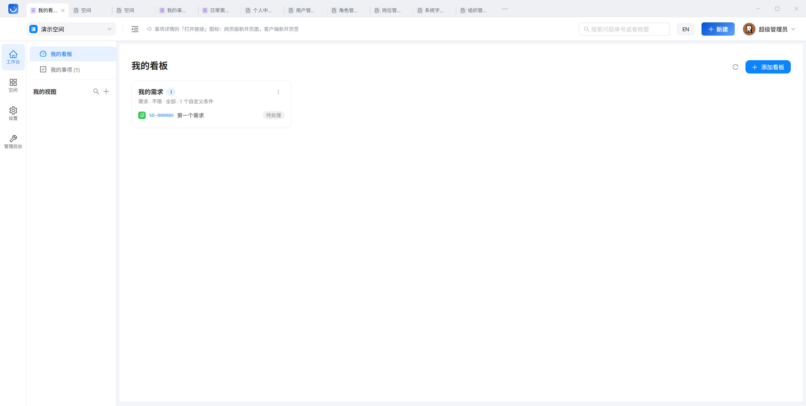

---

## 5. 手机 H5

独立的手机端（`/h5/`），适配 iPhone 17（402×874）和 iPhone 17 Pro Max（440×956）：灵动岛、底部横条安全区留白，毛玻璃导航栏与标签栏，苹果 / 谷歌 / 微信风格的视觉。网页版与客户端的页面、样式不受影响。

底部标签栏常驻：**看板 · 事项 · ＋新建 · 空间 · 我的**。

### 5.1 事项与详情

| 事项列表 | 事项详情 |
|---|---|
| 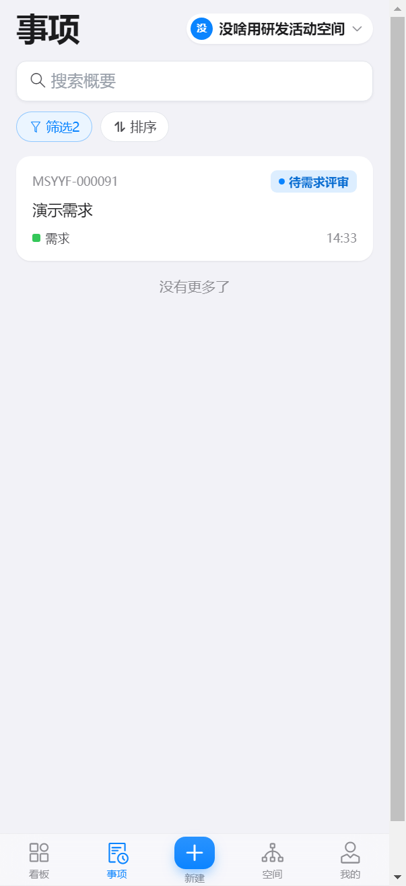 | 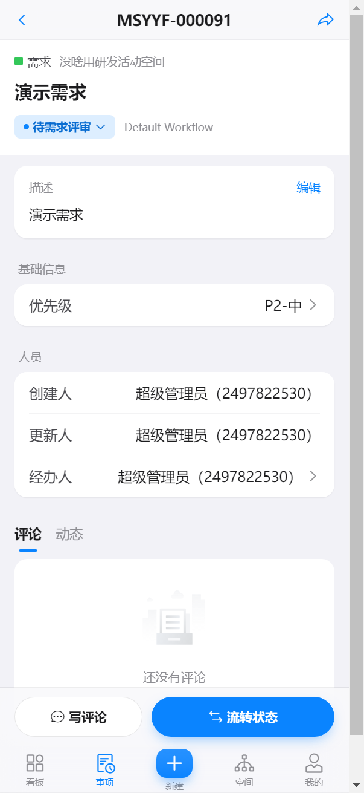 |

- **事项**：空间切换、搜索概要、下拉刷新、上拉加载；默认「经办人 = 当前用户、所有未结束状态」
- **详情**：概要点击即改；字段分组展示，点字段在底部弹层中编辑（支持全部字段类型）；描述；「流转状态」按工作流选择下一步；评论（发表、左滑删除自己的）、动态

### 5.2 筛选与新建

| 全局筛选 | 新建事项 |
|---|---|
| 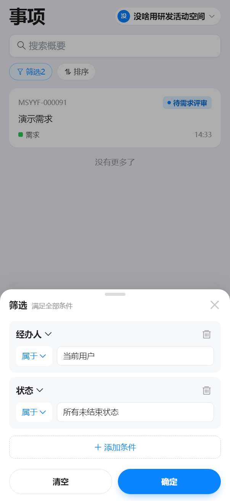 | 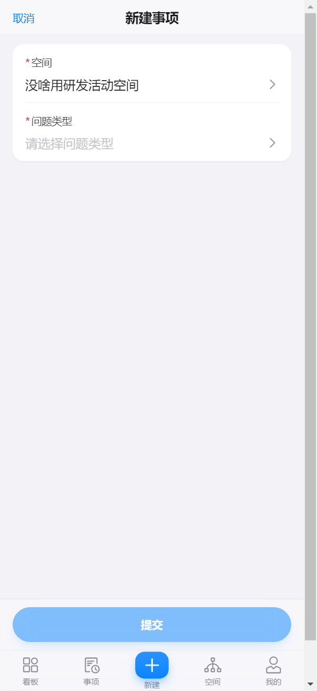 |

- **筛选 / 排序**：与网页版同一套规则，条件多选、人员搜索（含「当前用户」）、日期选择；设置记在本机
- **新建**：选空间 → 问题类型 → 填必填字段，选填字段收在「更多字段」里

### 5.3 看板、空间与我的

| 看板与视图 | 空间管理 | 我的 |
|---|---|---|
| 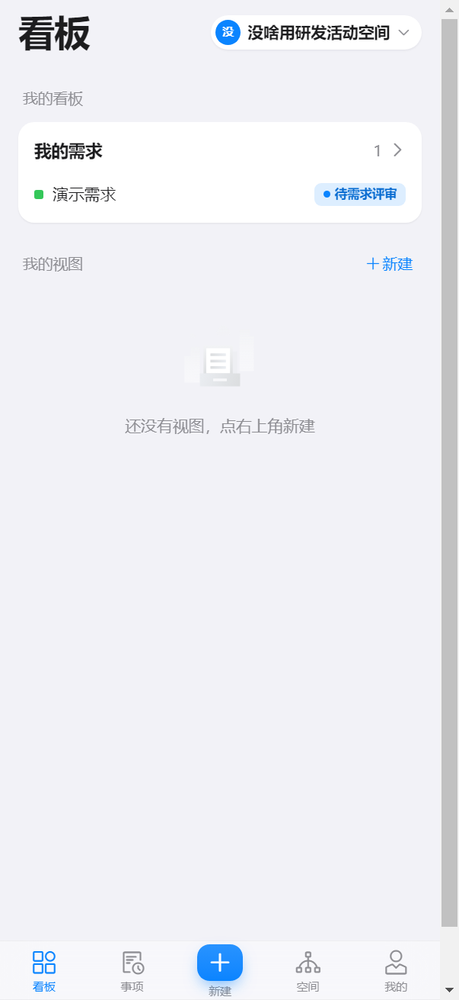 | 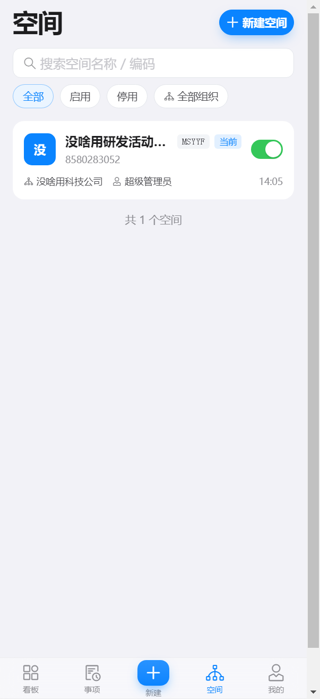 | 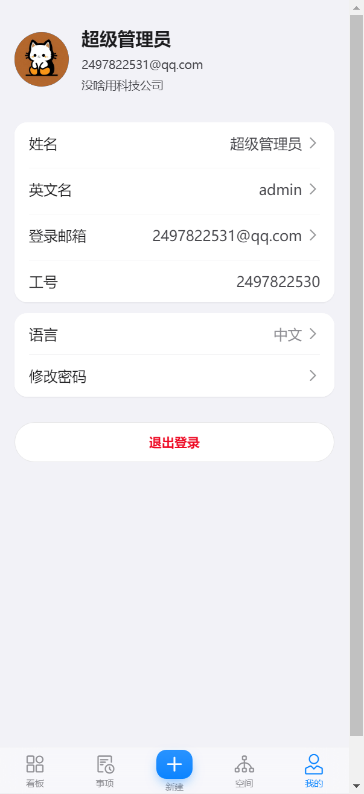 |

- **看板**：我的看板面板（前 5 条，点标题看全部）；我的视图可新建视图 / 文件夹、重命名、左滑编辑删除，看板类视图按状态分页签
- **空间**：与网页版一致的空间管理——搜索、状态 / 组织筛选、启停、新建、编辑、删除、设为当前空间
- **我的**：修改姓名 / 英文名 / 登录邮箱、切换中英文、修改密码、退出登录

---

## 6. 管理后台

管理后台集中管理组织与基础配置。

| 菜单 | 功能 |
|---|---|
| 用户管理 | 新增 / 编辑 / 删除用户，设置组织、空间、岗位、角色、在职状态；新用户默认密码 `123456`，支持**重置密码** |
| 角色管理 | 角色及权限 |
| 岗位管理 | 岗位与所属组织 |
| 组织管理 | 组织树（公司 / 部门） |
| 系统字段 | 字段类型、展示 / 必填 / 可编辑场景、关联问题类型、支持的操作符 |
| 国际化翻译 | 维护中文原词 → 英文译文（见下一节） |

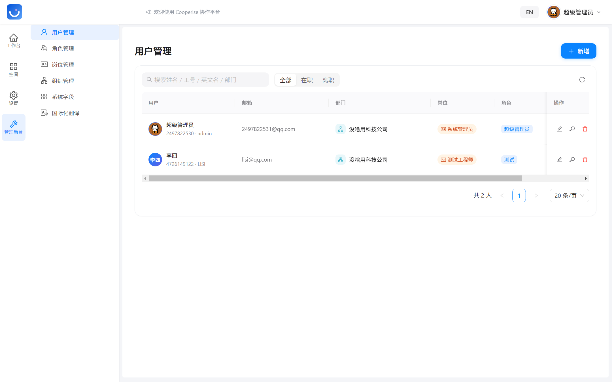

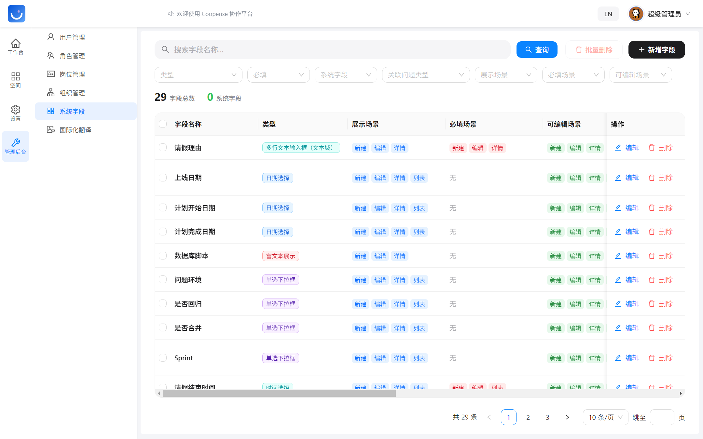

---

## 7. 国际化

三端都支持**中文 / English** 一键切换（登录页底部、顶栏 EN 按钮、H5「我的 → 语言」），切换后立即生效、无需刷新。

- **译文全部来自后端**：管理后台「国际化翻译」维护中文原词与英文译文，系统启动时调用 `GET /i18n/all?lang=en` 加载全部译文（无需登录），前端不再内置翻译；最近一次的译文缓存在本机，接口暂时不可用时也能显示英文
- **支持占位**：原词里用 `{0}` `{1}` 表示变化的部分，如 `共 {0} 个空间` → `{0} spaces`
- **请求头带语言**：每个请求都带 `Accept-Language: zh / en`，后端可据此返回对应语言的提示
- 新增界面文案后，在「国际化翻译」里补一条即可，无需发版

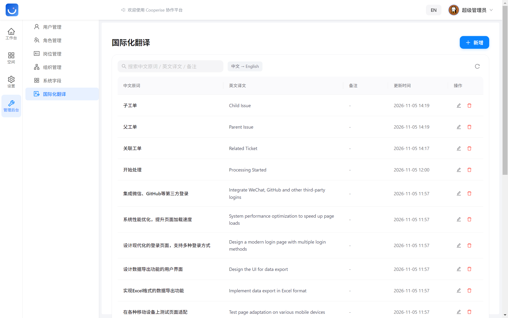

---

## 8. 三端功能对照

| 功能 | 网页版 | 桌面客户端 | 手机 H5 |
|---|:---:|:---:|:---:|
| 登录、记住账号、中英文切换 | ✅ | ✅（可记住密码） | ✅ |
| 我的看板 | ✅ 增删改面板 | ✅ | ✅ 查看 |
| 我的事项：列表、搜索 | ✅ | ✅ | ✅ |
| 全局筛选、排序 | ✅ | ✅ | ✅ |
| 列设置、表格内编辑、批量操作 | ✅ | ✅ | — |
| 事项详情：查看、编辑字段、流转状态 | ✅ | ✅ | ✅ |
| 评论、变更动态 | ✅ | ✅ | ✅ |
| 父子 / 关联事项、拆分、指派、复制 | ✅ | ✅ | — |
| 新建事项 | ✅ 模板 / 保存为模板 | ✅ | ✅ 按问题类型表单 |
| 视图：列表 / 看板 | ✅ | ✅ | ✅（列表展示，看板按状态分页签） |
| 视图：甘特 / 日历 / 上线清单 | ✅ | ✅ | 以列表展示 |
| 视图 / 文件夹管理 | ✅ | ✅ | ✅ |
| 空间管理 | ✅ | ✅ | ✅ |
| 空间配置（问题类型 / 模板 / 字段 / 工作流 / 按钮） | ✅ | ✅ | — |
| 管理后台（用户、角色、岗位、组织、字段、国际化） | ✅ | ✅ | — |
| 个人信息、修改密码 | ✅ | ✅ | ✅ |
| 多页签、拖动排序、自绘窗口按钮 | — | ✅ | — |
| MCP（AI 助手接入） | — | ✅ | — |

---

## 9. 开发与部署

### 本地开发

```bash
pnpm install
npm run dev              # 网页版 + H5：http://localhost:8083/ 、http://localhost:8083/h5/
npm run electron:dev     # 桌面客户端（复用 8083 的开发服务）
```

开发服务监听 `0.0.0.0`，内网同事可用「本机 IP:8083」访问；前端统一请求同源 `/api`，由开发服务代理到后端（`VITE_PROXY_TARGET`，默认 `http://localhost:8080`）。

### 构建

| 命令 | 产物 |
|---|---|
| `npm run build` | 网页版 `dist/` + 手机 H5 `dist/h5/` |
| `npm run build:h5` | 仅手机 H5 |
| `npm run build:lan` / `npm run preview:lan` | 内网部署版本（走同源 `/api` 代理）及本地预览 |
| `npm run electron:build` / `electron:build:mac` | Windows / macOS 客户端安装包 |
| `npm run ios:sync` / `ios:open` | iOS App（需在 Mac 上用 Xcode 打开） |

### 部署

- 前端：`docker/web/Dockerfile` 构建后由 nginx 托管 `dist/`；`/h5/` 下的前端路由回退到 `h5.html`（见 `nginx.conf`）
- 后端：`faiz` 为 Spring Boot 服务；数据库变更脚本在 `faiz/docs/sql/`（国际化相关：`faiz_i18n_20261105.sql` 建表、`faiz_i18n_data_20261105.sql` 初始译文、`faiz_i18n_h5_20261106.sql` H5 补充译文）
- Electron 下载镜像通过环境变量 `ELECTRON_MIRROR`、`ELECTRON_BUILDER_BINARIES_MIRROR` 配置（Dockerfile 已设置）
